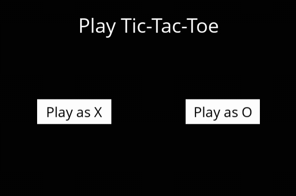

# 🤖 Tic-Tac-Toe AI — Minimax with Alpha-Beta Pruning


An unbeatable implementation of the classic **Tic-Tac-Toe** game powered by the **Minimax** algorithm optimized with **Alpha-Beta Pruning** for real-time decision-making under zero-sum, perfect-information game theory.

Developed as part of Harvard's **CS50's Introduction to Artificial Intelligence with Python** course.


## 📸 Demo



## 💡 About the Project

The goal of this project is to build an unbeatable autonomous agent capable of playing optimally against a human opponent. Because Tic-Tac-Toe is a mathematically solved game, optimal strategy from both players leads inevitably to a **draw (utility score of 0)**.

Whenever a human player makes a mistake or a sub-optimal move, the AI immediately detects the state evaluation shift and forces an unconditional victory.

### Key Highlights:
- **Decision Engine:** Decision-tree traversal using the classic Minimax framework.
- **Performance Optimization:** Optimized with **Alpha-Beta Pruning**, pruning ~90% of non-viable state branches without losing mathematical precision.
- **Graphical Interface:** Responsive visual board rendering built using `Pygame` with full mouse interaction support.


## 🧠 How the Algorithm Works

### 1. Minimax Algorithm
The Minimax framework assumes both players act rationally with perfect play:
* **MAX ($X$):** Attempts to maximize the final utility score ($\text{Score} = +1$).
* **MIN ($O$):** Attempts to minimize the final utility score ($\text{Score} = -1$).
* **Tie Game:** ($\text{Score} = 0$).

The AI recursively explores all future board states down to terminal conditions, propagating utility values backward up the decision tree.

### 2. Alpha-Beta Pruning
To prevent computing redundant or sub-optimal decision subtrees, two boundary bounds are passed down the recursive search:
* $\alpha$: The highest score (maximum) player $X$ is guaranteed so far.
* $\beta$: The lowest score (minimum) player $O$ is guaranteed so far.

Whenever a subtree reveals the condition **$\alpha \ge \beta$**, exploration of that branch is instantly terminated (`break`). A rational opponent would never allow the game state to reach that configuration, rendering further computation wasteful.

```text
                [Current State]
               /               \
       [Move A (Center)]      [Move B (Corner)]
         /                  \
   Guarantees 0 (Tie)     Opponent forces -1 (O wins)
                                    |
                             [ALPHA-BETA PRUNING] ✂️
                     (Instantly drops remaining simulation)
```


## 🛠️ Built With

- Language: Python 3.12
- GUI Engine: Pygame
- Paradigms: Functional Programming / Recursion


## 🚀 Getting Started
### Prerequisites

Ensure you have **Python 3.12** installed on your system.

1. **Clone the repository:**
    ```bash
    git clone [https://github.com/your-username/Tic-Tac-Toe-IA.git](https://github.com/your-username/Tic-Tac-Toe-IA.git)
    cd Tic-Tac-Toe-IA
    ```

2. **Set up a virtual environment (Optional, but recommended):**
    
    ```bash
    python3.12 -m venv venv
    source venv/bin/activate  # Linux / macOS
    # or: venv\Scripts\activate  # Windows
    ```


3. **Install dependencies:**
    ```bash
    pip install -r requirements.txt
    ```


4. **Launch the game:**
    ```bash
    python runner.py
    ```

## 📁 Repository Structure

```text
├── tictactoe.py   # [Developed by me] Core AI engine (Minimax, Alpha-Beta, state logic & evaluation)
├── runner.py      # [Provided by Harvard CS50 AI] Pygame GUI handling rendering and user interactions
├── requirements.txt # Project dependencies
└── README.md      # Project documentation
```

## 📄 License
This project is licensed under the [MIT License](LICENSE). Feel free to use, modify, and distribute it for learning purposes.

## 📞 Contact
If you have any questions or would like to get in touch, feel free to email me at: felipemmarcioli@gmail.com
